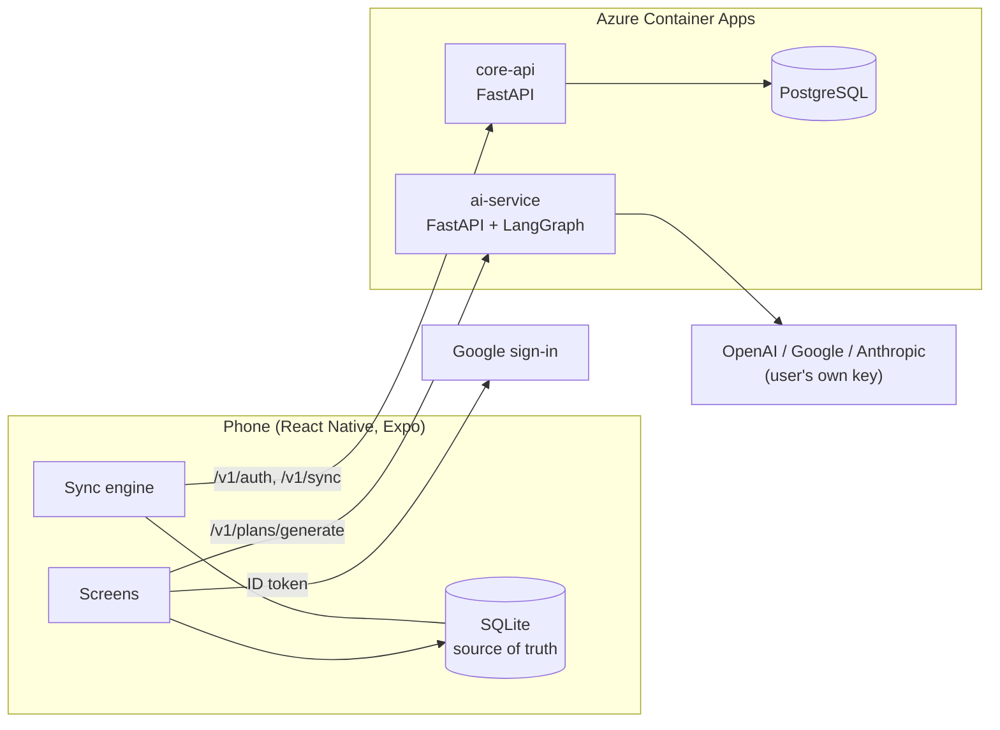

# Repwise

A mobile app that drafts a workout plan from your goals, schedule and the equipment you actually have (nothing, a treadmill, a home gym or a full gym), then tracks your workouts on a calendar. Use it as a guest with data on your phone, or sign in with Google to back up and sync across phones. AI plans use your own OpenAI, Google or Anthropic API key; without one, Repwise works as a manual tracker.

## Features

- **Onboarding:** goal, experience, days per week, session length, areas to go easy on, and equipment picked from a photo catalogue with presets.
- **AI plans:** a LangGraph workflow drafts a plan from exercises your equipment allows, checks it in code, repairs it, and falls back to a rule-based plan if needed. Regenerate with focus muscles.
- **Manual plans:** build days from 145 exercises with photos and how-to steps.
- **Tracking:** week strip and month calendar with a coloured plate per workout, last session's numbers in every set, rest timer, heavier-weight hints, plates per side, history and totals.
- **Accounts:** guest mode, or Google sign-in with two-way sync; guest data comes along on first sign-in.

## Architecture



The phone works fully offline; the backend adds sync and AI. Decisions are recorded in [docs/adr](docs/adr).

## Layout

```text
apps/mobile/            React Native + Expo app (TypeScript, Expo Router, Drizzle on SQLite)
services/core-api/      FastAPI: Google sign-in, tokens, sync (PostgreSQL, Alembic)
services/ai-service/    FastAPI + LangGraph: stateless plan generation
packages/contracts/     Plan JSON schema and both services' OpenAPI specs
infra/                  docker compose for local runs; Azure Bicep and deploy scripts
docs/                   Decision records and setup guides
.github/workflows/      CI per component, Postgres tests, deploy to Azure
```

## Run it locally

Prerequisites: Node.js 22, Python 3.12 with [uv](https://docs.astral.sh/uv/), and Expo Go on an Android phone.

```bash
# Services (two terminals)
cd services/core-api && uv run alembic upgrade head && uv run uvicorn app.main:app --host 0.0.0.0 --port 8001
cd services/ai-service && uv run uvicorn app.main:app --host 0.0.0.0 --port 8002

# App: scan the QR code with Expo Go (same Wi-Fi)
cd apps/mobile && npm install && npx expo start
```

Guest mode and AI generation work in Expo Go. Google sign-in needs the development build: see [docs/setup-accounts.md](docs/setup-accounts.md). `docker compose -f infra/docker-compose.yml --env-file .env up --build` runs both services with Postgres instead.

## Deploy

`./infra/azure/deploy.sh` creates everything on Azure and prints the URLs; see [infra/azure](infra/azure/README.md). `eas build --profile preview --platform android` then produces an installable APK.

## Checks

| Component | Command |
| --- | --- |
| `apps/mobile` | `npm run check` |
| `services/*` | `uv run ruff check . && uv run ruff format --check . && uv run mypy app tests && uv run pytest` |
| `packages/contracts` | see its README |

CI runs the same per component on every pull request, plus the core API tests against Postgres.

## Roadmap

| Phase | Status |
| --- | --- |
| 1. Foundations | Done |
| 2. Offline tracker | Done |
| 3. AI generation | Done |
| 4. Accounts and sync | Done |
| 5. Deploy and polish | Azure templates, deploy pipeline, app icon |
| v2 | Paid subscription with Repwise-provided AI, iPhone builds, Sign in with Apple, cardio and progression in plans |
